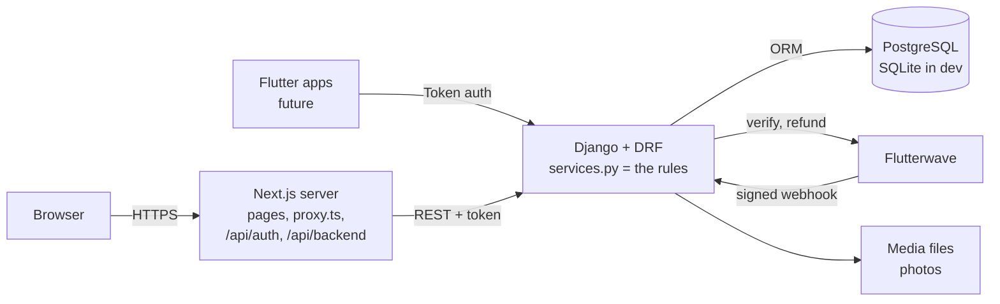
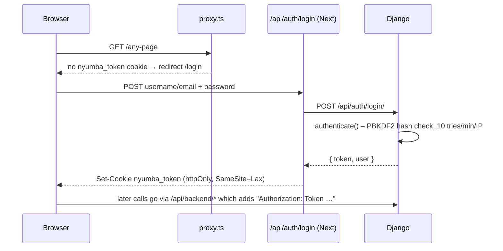
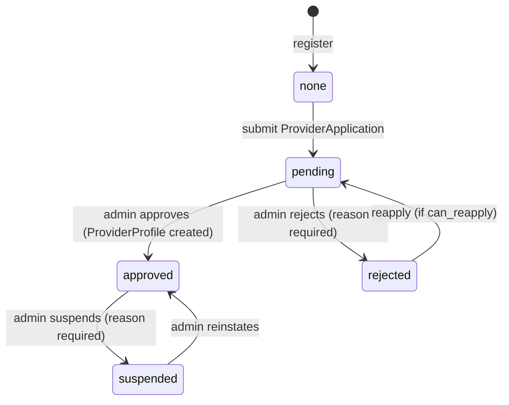
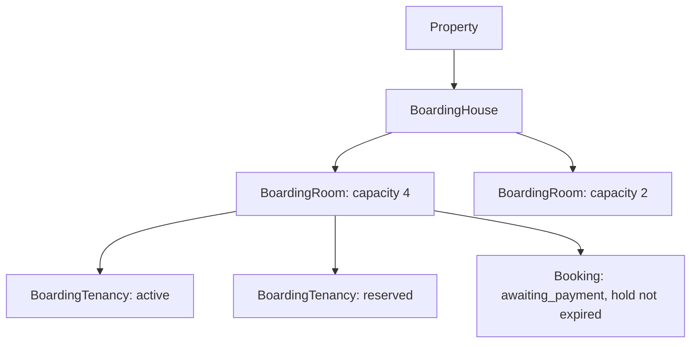
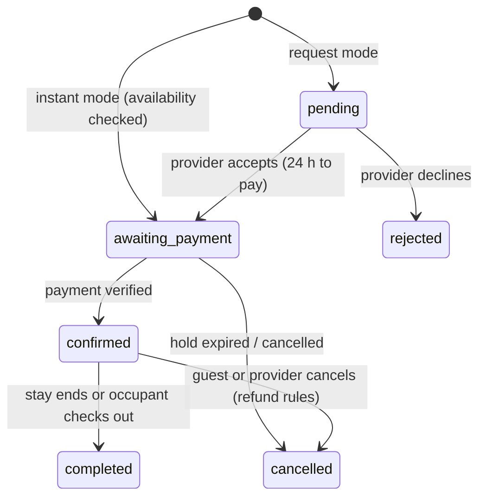
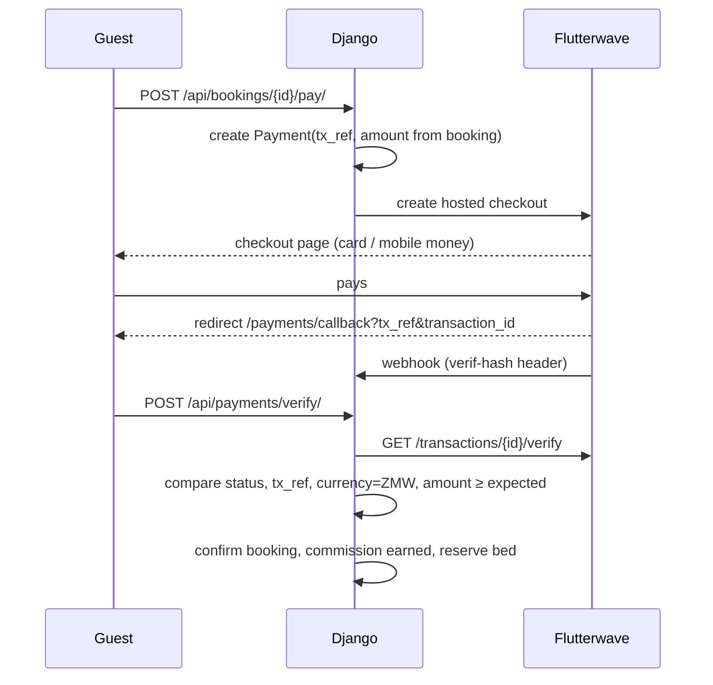

# How Nyumba works

This document explains how Nyumba is built. Every section has two parts:

- **🧸 The simple version**: how you'd explain it to a five-year-old.
- **🔧 The technical version**: what actually happens in the code, with file names so you can go and look.

---

## 1. The big picture

### 🧸 The simple version

Imagine a big town market.

- **The shop window** is what people look at. It's pretty, it has pictures of houses, and you can point at things. That's the **website** (Next.js).
- **The shopkeeper** stands behind the counter. You can't walk into the back room yourself; you ask the shopkeeper, and the shopkeeper checks the rules before doing anything. That's the **server** (Django).
- **The big notebook** in the back room is where the shopkeeper writes everything down: who lives where, who paid, who booked what. That's the **database** (PostgreSQL, or SQLite while we're testing).
- **The bank** is a separate building. When someone pays, the shopkeeper phones the bank to make sure the money really arrived. That's **Flutterwave**.

The shop window is never allowed to change the notebook directly. It always has to ask the shopkeeper.

### 🔧 The technical version



| Layer | Tech | Lives in |
|---|---|---|
| Pages people see | Next.js 16 (App Router), React 19, TypeScript, Tailwind CSS 4 | `frontend/app`, `frontend/components` |
| Map | MapLibre GL + OpenFreeMap tiles (free, no key) | `frontend/components/map/ResultsMap.tsx` |
| Gatekeeper on the web side | Next.js Proxy (what used to be called middleware) + Route Handlers | `frontend/proxy.ts`, `frontend/app/api/*` |
| Rules and data | Django 6.1 + Django REST Framework 3.18 | `backend/apps/properties` |
| Storage | PostgreSQL via `DATABASE_URL`, SQLite fallback | `backend/config/settings.py` |
| Payments | Flutterwave Standard (cards + Zambian mobile money), plus a local sandbox | `backend/apps/properties/gateways.py` |

The most important design rule is **API-first**: every rule lives in Django. The website is just one client of that API; the future Android and iOS apps (Flutter) will be another, and they get exactly the same behaviour for free.

---

## 2. Signing in

### 🧸 The simple version

When you walk into the market, a guard at the gate checks your **wristband**. No wristband, no entry: you're sent to the ticket desk (the login page).

When you log in, you get a wristband. The clever part: the wristband is **sewn into your sleeve**. You can show it, but nobody can take it off and copy it, not even sneaky code hiding on a web page.

When you log out, the shopkeeper tears up the record of your wristband, so it stops working everywhere.

### 🔧 The technical version



- **The wristband** is a DRF auth token. On the web it's stored in an **httpOnly cookie**, so JavaScript on the page can't read it (this blocks a whole class of token-stealing attacks). Mobile apps keep the token themselves and send the `Authorization` header.
- **The guard at the gate** is `frontend/proxy.ts`. It's a quick, optimistic check; the real check happens in Django on every request, because `DEFAULT_PERMISSION_CLASSES = [IsAuthenticated]` in `settings.py`. Only login, register, password reset and the payment webhook are open.
- **Passwords** are never stored, only salted PBKDF2 hashes (Django's default), and must pass Django's password validators.
- **Password reset** uses Django's signed, time-limited tokens (2 hours). The "forgot password" form answers the same way whether the email exists or not, so it can't be used to discover accounts.
- **Logout, password change and reset** delete the token on the server, which signs you out on every device.
- **Suspended accounts** have `is_active = False`; token authentication refuses them instantly.

---

## 3. One person, one account, two hats

### 🧸 The simple version

Everyone gets one account, like one library card. Anyone can **look at houses** and **book** them.

If you also want to **rent out** your own house, you ask the market manager for a second hat: the **provider hat**. The manager (an admin) reads your request and says yes or no. If they say yes, you can switch hats whenever you like, and you're still the same person with the same favourites and bookings.

If a provider breaks the rules, the manager can take the hat away (suspend). Their houses disappear from the shop window until the hat is given back.

### 🔧 The technical version



- `UserProfile`: everyone has one. Holds phone, town, optional student details, and `active_mode` (`marketplace` or `provider`), which is saved on the server so web and mobile agree.
- `ProviderApplication`: the request. A **partial unique constraint** in the database means a user can only ever have one *pending* application.
- `ProviderProfile`: exists only after approval; its `status` is `approved` or `suspended`.
- Permission classes in `backend/apps/properties/permissions.py`: `IsApprovedProvider` guards every provider endpoint; `IsPlatformAdmin` (`user.is_staff`) guards admin endpoints.
- `POST /api/me/mode/` switches hats and refuses unless you're an approved, active provider.

---

## 4. The shop window (the marketplace)

### 🧸 The simple version

The big screen is split like a picture book: a **map** on the left, **cards** on the right. Every house is a blue dot on the map. When lots of dots are close together they huddle into one bigger dot with a number on it, so the map doesn't get messy. Point at a card and its dot lights up; tap a dot and the page jumps to its card.

The map is also a **magic window**: move it, and the list only shows houses you can see through it.

Only houses that are **approved by the manager, switched on by their owner, and owned by someone still wearing the provider hat** ever appear here.

### 🔧 The technical version

- **Search endpoint:** `GET /api/listings/search/`, defined in `api/marketplace.py`. It always starts from `Listing.public()`, a single queryset that encodes "approved + published + owner's provider profile approved". There is no other way for a listing to reach the public.
- **13 filters:** map bounding box (`bbox=minLng,minLat,maxLng,maxLat`) or town, free text, kind (rent/sale/stay), property type, bedrooms, bathrooms, price range, size range, furnishing, available-by date, amenities, instant-only, verified-only, plus sort. They're validated by `ListingSearchSerializer`.
- **Filters live in the URL** (`lib/listing-filters.ts`). Copy the address and someone else sees the same search; Back and Forward work.
- **Fast typing, no wasted requests:** searches are debounced (250 ms) and stale requests are cancelled with `AbortController`.
- **Clustering** is done by MapLibre on the GPU from a GeoJSON source (`cluster: true, clusterRadius: 46`). Card hover sets an `active` property that the map layers style with data-driven expressions.
- **Phone vs desktop:** a `useSyncExternalStore` media-query hook knows whether the map is actually on screen; the map-area filter only applies when it is.
- **Layout:** the map takes 55% of the width; the card under it has a fixed height (`h-24`), so the map keeps the same map-to-card ratio as the design reference at any window height.

---

## 5. Boarding houses: the beds are counted, never guessed

### 🧸 The simple version

A boarding house is like a **box of egg cartons**. The house is the box, each room is a carton, and each egg cup is a bed.

Nobody writes "3 beds taken" on the carton with a pen, because pens lie when people forget to update them. Instead, every time someone asks, we **count the eggs**: who has checked in, who has paid and is on the way, and who is in the middle of paying right now. Whatever is left is free.

And if two students try to grab the last bed at the exact same moment, a **"one at a time" sign** goes up on that carton, so only one of them gets it.

### 🔧 The technical version



`services.room_occupancy(room)` computes, from real rows:

| Count | From |
|---|---|
| occupied | tenancies with `status = active` (checked in) |
| reserved | tenancies with `status = reserved` (paid, moving in later) |
| held | bookings `awaiting_payment` whose `payment_due_at` is in the future |
| **available** | `capacity − occupied − reserved − held` |

- **Never over capacity:** `register_occupant`, `create_room_booking`, `accept_booking` and payment confirmation all run inside `transaction.atomic()` and lock the room row with `SELECT … FOR UPDATE` before re-counting. A test fires three registrations at a one-bed room: results 201, 409, 409.
- **Database constraints** back this up: room capacity ≥ 1, unique room names per house, and one open bed per account (`one_open_tenancy_per_student`, a partial unique constraint).
- **Students only see space:** the boarding search drops any room with no free bed, and any house left with no matching rooms.
- **Walk-in occupants:** providers can register people without a Nyumba account (cash tenants); linking a username lets the student see their placement too.

---

## 6. Booking: asking nicely vs. grabbing it

### 🧸 The simple version

There are two kinds of houses:

- **"Ask first" houses.** You knock and ask, "May I stay?" The owner says yes or no. If yes, you have a day to pay.
- **"Grab it" houses.** If the dates are free, you take them immediately and have **30 minutes** to pay. While you're paying, nobody else can take them.

If you don't pay in time, your hold melts away like ice cream and the dates are free again.

### 🔧 The technical version



- All transitions live in `backend/apps/properties/services.py` (`create_listing_booking`, `create_room_booking`, `accept_booking`, `reject_booking`, `cancel_booking`).
- **No double booking:** the date-overlap query (`check_in < other.check_out AND check_out > other.check_in`) only counts *confirmed* and *unexpired held* bookings, and runs while the listing row is locked.
- **Pending requests don't block anyone** (a deliberate choice: one unanswered request shouldn't freeze a house). Conflicts are re-checked at the moment the provider accepts.
- **The server sets the price.** The total is always `unit_price × nights or months`, computed in Python with `Decimal`. A `total_amount` sent by the browser is ignored (there's a test for that).
- **Expiry is lazy *and* scheduled:** every time bookings are read, stale holds are released; `python manage.py expire_bookings` can also run from a scheduler.
- **Refund rules:** a guest who cancels a paid booking at least 48 hours before check-in gets everything back; a provider cancellation always refunds in full.

---

## 7. Paying: we always phone the bank

### 🧸 The simple version

When you pay, you don't hand your card to Nyumba. You go to the bank's own counter (Flutterwave's payment page) and pay there.

When you come back and say "I paid!", Nyumba doesn't just believe you. It **phones the bank** and asks: "Did this person really pay, the right amount, in Kwacha, for this exact booking?" Only if the bank says yes does the booking get a gold star.

The bank also sends Nyumba a **sealed letter** (a webhook). Nyumba checks the seal, then phones the bank anyway, just to be sure.

### 🔧 The technical version



- **Gateway interface** (`gateways.py`): each gateway implements `create_checkout`, `verify` and `refund`. `FlutterwaveGateway` talks to the real API; `SandboxGateway` simulates it locally and is refused whenever a real gateway is configured.
- **Never trust the browser:** `services.verify_payment()` compares what the gateway reports with what Nyumba charged. A tampered amount fails the payment (tested).
- **Idempotent:** the `Payment` row is locked; a payment that's already settled is returned as-is; `gateway_transaction_id` is unique, so one real transaction can't pay for two bookings.
- **Webhook security:** the `verif-hash` header is compared in constant time (`hmac.compare_digest`), then the payment is re-verified through the API, so a forged webhook body can't confirm anything.
- **Late payments:** if money arrives after a hold expired, the booking is confirmed only if the dates or bed are still free; otherwise an automatic refund is recorded.
- **Audit trail:** `Payment`, `Refund`, `Commission` and `ProviderPayout` rows, plus printable receipts at `/payments/{id}/receipt`.

---

## 8. Nyumba's share (commission)

### 🧸 The simple version

When a booking costs K100, Nyumba keeps a small slice, say K10, for running the market, and the owner gets the rest. The manager can change the slice size, separately for short stays, rentals and boarding beds.

The slice is cut **once**, at the moment you book, and written down. If the manager changes the slice tomorrow, yesterday's bookings don't change.

### 🔧 The technical version

`services.price_breakdown(category, gross)` is the only place money is split:

```
commission      = gross × CommissionRate.rate            (default 10%)
processing_fee  = gross × CommissionRate.processing_fee  (default 0%)
provider_net    = gross − commission − processing_fee
```

- Rates live in the `CommissionRate` table (one row per category), editable on the admin's *Commission & categories* page, with validators limiting them to 0–50% and 0–20%.
- The result is stored on each booking's `Commission` row, which moves through `pending → earned → paid_out` (or `refunded`).
- All amounts use Python `Decimal`, rounded half-up to the ngwee (`ROUND_HALF_UP`); floats never touch money.
- Payouts: the admin sees what each provider is owed, sends the money, and records the transfer reference. That bundles those commissions into a `ProviderPayout`.

---

## 9. Telling people what happened

### 🧸 The simple version

Whenever something important happens (a new booking request, a yes, a no, a payment), Nyumba drops a note in that person's **letterbox**. The bell at the top of the screen gets a little red dot until you read it.

### 🔧 The technical version

- `services.notify(user, kind, title, body, link)` creates a `Notification` row; it's called from every business transition.
- `GET /api/notifications/` is paginated and returns an `unread` count; the bell (`components/NotificationBell.tsx`) polls once a minute and on every page change.
- Enquiries (`Inquiry`) and listing reports (`ListingReport`) also notify the provider or admins.

---

## 10. The manager's office (admin)

### 🧸 The simple version

The market manager has an office with a big board. On it: how many people joined, which new providers are waiting for a hat, which houses need checking, any complaints, and how much money came in. From here the manager can say yes or no, take hats away, give refunds, and change Nyumba's slice.

### 🔧 The technical version

- Endpoints under `/api/admin/*` in `api/admin.py`, all guarded by `IsPlatformAdmin`.
- Moderation: listings move `pending → approved | rejected | removed`; boarding houses have `is_approved`. A reason is required for any rejection or removal, and the provider is notified.
- Finance: a financial report by date range (grouped by category and by provider), all transactions, partial or full refunds through the gateway, and payout recording.
- Django's own back office is still available at `/django-admin/` as a fallback; payments are read-only there.

---

## 11. How the code is organised

### 🧸 The simple version

Each part of the shopkeeper's job has its own drawer, so nothing gets mixed up: one drawer for **what things are** (models), one for **the rules** (services), one for **talking to customers** (the API), and one for **talking to the bank** (gateways).

### 🔧 The technical version

```
backend/apps/properties/
├── models.py          what things are: tables, constraints, indexes
├── services.py        the rules: bookings, availability, payments, commission, approval
├── gateways.py        talking to the bank: Sandbox + Flutterwave behind one interface
├── serializers.py     turning rows into JSON and checking input
├── permissions.py     who may do what
├── api/
│   ├── accounts.py    sign in/up, reset, profile, switch hats, apply
│   ├── marketplace.py search, details, favourites, bookings, payments, webhook
│   ├── provider.py    provider tools and dashboard numbers
│   └── admin.py       admin tools and reports
├── urls.py            every /api/ route in one list
├── management/commands/
│   ├── seed_demo.py         demo homes, boarding houses, test accounts
│   ├── load_demo_photos.py  real stock photos for demo listings
│   └── expire_bookings.py   release unpaid holds on a schedule
└── tests.py           45 behaviour tests

frontend/
├── proxy.ts                     the guard at the gate
├── app/(auth)/                  login, register, forgot/reset password
├── app/(market)/                explore, properties, boarding houses, bookings, payments…
├── app/provider/                provider tools
├── app/admin/                   admin dashboard
├── app/api/auth/[action]/       sets and clears the httpOnly session cookie
├── app/api/backend/[...path]/   pass-through to Django that adds the token
├── components/kit.tsx           buttons, badges, panels: one visual language
└── lib/                         API client, session, favourites, formatting, types
```

**Views stay thin.** An endpoint reads input, calls one function in `services.py`, and returns JSON. That's why the same rules automatically apply to the website, the Flutter apps, the Django admin actions and the tests.

---

## 12. The cool bits, in one list

| Feature | Why it's neat |
|---|---|
| **Counted, not stored, occupancy** | Bed numbers can never drift out of sync, because they're recalculated from real tenancy and booking rows every time. |
| **Row locks on scarce things** | `SELECT … FOR UPDATE` on rooms and listings means two people clicking "book" at the same instant can't both win. |
| **Holds that expire** | Unpaid bookings reserve inventory only until `payment_due_at`, so no one can squat on a house. |
| **Server-side money** | Prices, totals, commission and payment results are calculated or verified by Django only. |
| **Gateway plug-in** | Swapping Flutterwave for another provider (for example Lenco) means writing one class with three methods. |
| **httpOnly session** | The login token is invisible to page scripts, and logout really logs you out everywhere. |
| **One API for every app** | Web today, Flutter tomorrow: same endpoints, same rules, same errors (`{"error": "...", "fields": {...}}`). |
| **Shareable searches** | All filters live in the URL. |
| **GPU map clustering** | Thousands of pins stay smooth because MapLibre clusters them on the graphics card. |
| **Database guard rails** | Check and partial-unique constraints (one pending application, one open bed per student, a booking targets exactly one thing) stop bad data even if code has a bug. |
| **Safe migrations** | Migration 0008 moved old data (providers, boarding capacity, booking statuses) into the new structure before dropping old columns. |

---

## 13. Running it yourself

```bash
# backend
cd backend
python manage.py migrate
python manage.py seed_demo          # demo data; passwords go to DEMO_ACCOUNTS.local.md
python manage.py load_demo_photos   # real photos for demo listings
python manage.py runserver

# frontend (new terminal)
cd frontend
npm run dev                         # http://localhost:3000

# tests
cd backend
python manage.py test apps.properties.tests
```

Configuration lives in `backend/.env` (template: `backend/.env.example`): `DATABASE_URL` for PostgreSQL, `PAYMENT_GATEWAY`, and the Flutterwave keys. If the frontend ever stops showing your changes, stop it, delete `frontend/.next`, and start it again.
